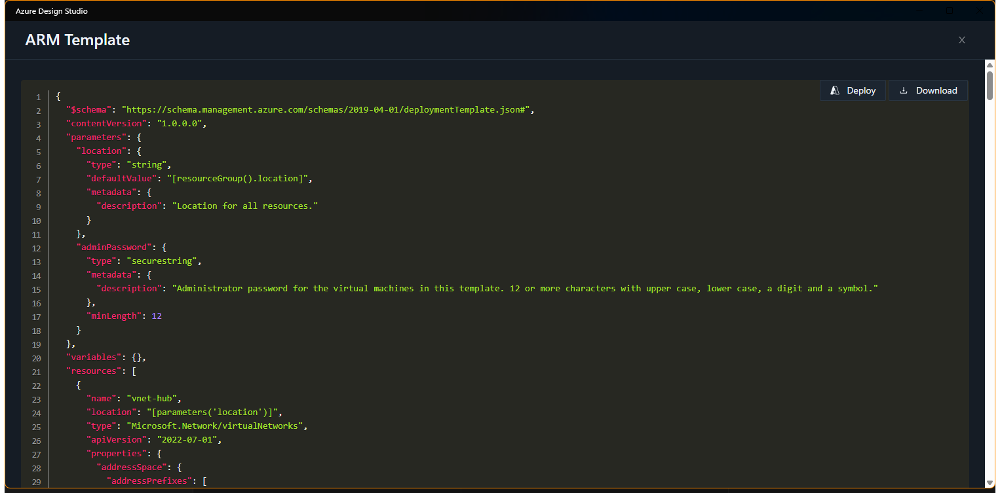

# Azure Design Studio

[](https://www.gnu.org/licenses/gpl-3.0)

**Azure Design Studio** is a desktop app for drawing Azure architectures visually and turning them into deployable infrastructure. Draw a design, check it against Azure's rules, estimate its cost, export it as ARM or Bicep, and run a What-If against a resource group before anything is deployed.

The app runs entirely on your machine. There is no server to host: it calls Azure directly with your own sign-in.

> **Status:** the Windows desktop app is the primary target and is under active development. A macOS build (Mac Catalyst) is planned. The browser (WebAssembly) version and its gRPC server still build and pass their tests, but they receive no new features.


---

## Features

### Design
- **Drag-and-drop canvas** with resources grouped the way Azure nests them: virtual networks contain subnets, subnets contain resources, and so on.
- **Resource palette** grouped into Gallery, Networking, Compute, Containers, Databases, Storage, Integration, Security & Ops, and AI & Analytics.
- **Gallery designs** to start from: hub-and-spoke, an API Management landing zone, and an AKS baseline architecture.
- **Inspector panel** for each resource's properties, plus a command palette (`Ctrl+K`) for every action.
- **Light and dark themes.**

### Check
- **Validate the design** against Azure resource rules (names, address ranges, required subnets, and similar), before you export or deploy.
- **Suggest globally unique resource names** for storage accounts, Key Vaults, and other names that must be unique.
- **Estimate monthly cost** from Azure's public retail price list.

### Export
- **ARM template** (JSON), with a preview and a download button.
- **Bicep** source.
- **Image** of the diagram.
- **Text design** (`.ads.json`) for saving and sharing a design. You can import these back in.

### Deploy
- **What-If review** shows exactly which resources will be created, changed, or deleted in the target resource group before anything runs.
- **Approve & deploy** runs the reviewed plan, and only that plan. Changes are blocked when the What-If shows deletions or when a guardrail protects a resource.
- **Deployment stacks** as an option, so the resources of one design are tracked and managed as a single unit.
- **Linked service principals** per subscription, with the secret kept in the Windows Credential Manager. Without one, the app uses your own signed-in identity.

### Analyze existing environments
- **Tenant scan** reads what is already deployed in your subscriptions and shows it alongside your designs.
- **Compare saved designs** to see what changed between two versions.
- **Guardrails** mark resources that the app must not touch.

---

## Install

### Requirements

| | |
|---|---|
| **Operating system** | Windows 10 version 2004 (build 19041) or later, x64 |
| **.NET SDK** | .NET 10 SDK (10.0.4xx or later) |
| **Workloads** | .NET MAUI (`dotnet workload install maui-windows`) |
| **Azure access** | An Azure account with at least Reader on the subscriptions you want to see. Deploying needs Contributor (or the role the deployment requires). |
| **Optional** | Azure CLI (`az`), used as a sign-in fallback when the Windows broker is unavailable |

### Build and run

```bash
git clone https://github.com/jacobeen3006/AzureDesignStudio.git
cd AzureDesignStudio

dotnet workload install maui-windows

dotnet build src/AzureDesignStudio.Desktop -c Debug -f net10.0-windows10.0.19041.0
```

Then start the built app:

```bash
src/AzureDesignStudio.Desktop/bin/Debug/net10.0-windows10.0.19041.0/win-x64/AzureDesignStudio.Desktop.exe
```

Or open `src/AzureDesignStudio.sln` in Visual Studio 2022 with the .NET MAUI workload installed, select `AzureDesignStudio.Desktop` as the startup project, and press F5.

### Sign in

1. Open **User account** in the top menu and choose **Sign in**.
2. Pick your account in the Windows sign-in window. The app asks Azure for permission to manage resources on your behalf (`user_impersonation`).

The sign-in uses the Entra app registration whose client ID is set in [`src/AzureDesignStudio.Desktop/appsettings.json`](src/AzureDesignStudio.Desktop/appsettings.json) (`AzureAd:ClientId`). The registration is a public client that accepts both work and personal Microsoft accounts. To use your own registration, create one with:

- supported account types: accounts in any organizational directory and personal Microsoft accounts
- *Allow public client flows*: enabled
- redirect URIs: `ms-appx-web://microsoft.aad.brokerplugin/<client-id>` and `http://localhost`
- API permission: Azure Service Management → `user_impersonation` (delegated)

Then put its client ID in `appsettings.json`.

If the Windows sign-in broker is not available, the app falls back to the token from `az login`. Signing out turns that fallback off.

### Where your data lives

Everything is stored locally in the app's data folder (MAUI's `FileSystem.AppDataDirectory`):

- `workspace.db`: saved designs, scans, and snapshots
- `deploy.db`: deployment approvals, guardrails, linked subscriptions, and the audit log

Saved designs stay on your machine and are not uploaded anywhere.

---

## Screenshots

**ARM template export.** Preview the generated template, then download it or deploy it.



---

## Solution structure

```
AzureDesignStudio.sln
├── AzureDesignStudio.Desktop          — .NET MAUI Blazor Hybrid app for Windows (the main target)
├── AzureDesignStudio                  — Blazor WebAssembly client (browser build, no new features)
├── AzureDesignStudio.Services         — Service logic for designs, deployment, and prices; runs in-process in the desktop app
├── AzureDesignStudio.Server           — ASP.NET Core gRPC host for the browser build
├── AzureDesignStudio.Core             — Resource models, diagram logic, ARM generation, validation
├── AzureDesignStudio.AzureResources   — ARM resource type definitions
├── AzureDesignStudio.Discovery        — Tenant scans, What-If, guardrails, deployment stacks
├── AzureDesignStudio.Workspace        — SQLite storage for designs, scans, and audit
├── AzureDesignStudio.SharedModels     — Protobuf contracts
├── AzureDesignStudio.Mcp              — Read-only MCP server over the local workspace
├── AzureDesignStudio.SourceGeneration — Roslyn source generator for DTO mappings
├── AzureDesignStudio.Core.Tests       — Unit tests (run with `--filter "Category!=LiveAzure"`)
└── AzureDesignStudio.Server.Tests     — Tests of the gRPC services and the in-process host
```

### Tests

```bash
dotnet test src/AzureDesignStudio.Core.Tests --filter "Category!=LiveAzure"
dotnet test src/AzureDesignStudio.Server.Tests
```

---

## Built with

- .NET 10, Blazor, .NET MAUI Blazor Hybrid
- [Ant Design Blazor](https://antblazor.com/) for the UI
- [Z.Blazor.Diagrams](https://github.com/Blazor-Diagrams/Blazor.Diagrams) for the canvas
- Microsoft Authentication Library (MSAL) with the Windows account broker
- Entity Framework Core with SQLite
- Azure.ResourceManager and Azure.Deployments.Core

---

## Background

Azure Design Studio won **3rd place** in the Microsoft Global Hackathon 2022.

## License

Released under the [GNU General Public License v3.0](https://www.gnu.org/licenses/gpl-3.0).
