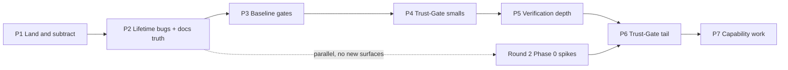

# Azure Design Studio — Execution Plan: Next Phases

> **Date:** 2026-10-21 · **Baseline:** `main` @ `29b5017`, 120 commits ahead of `origin/main`.
> **Authority split:** `docs/v3-plan.md` owns scope (N1–N50) and is not re-planned here; `docs/v2-plan.md` records delivered phases 6–13; `docs/top-100-ui-improvements.md` owns Round 2 surfaces. **This document owns execution order, gates, and the next concrete actions.**
> No roadmap phase needs an initial plan. Every phase below slices already-decided work into shippable gates, with a verification command per task.

---

## 1. Verified state (2026-10-21)

| Check | Result | Evidence |
|---|---|---|
| Offline suite | **755 passed, 0 failed, 2 s** | `dotnet test src/AzureDesignStudio.Core.Tests -c Release --filter "Category!=LiveAzure"` |
| Test volume | 625 `[Fact]`/`[Theory]` across 68 files, one project | `grep -rhoE "\[(Fact\|Theory)\]" … \| wc -l` |
| Projects | **11** `.csproj` | `ls src/*/*.csproj \| wc -l` |
| Working tree | **35 modified, 1 deleted, 18 untracked** | `git status --porcelain` |
| CI | Server, WASM, MCP, Core.Tests on `ubuntu-latest`; **no Desktop job** | `.github/workflows/build.yml` |
| Build policy | **absent** — no `global.json`, `Directory.Build.props`, `Directory.Packages.props`, `.editorconfig` | filesystem |
| Migrations | **absent** — no `Migrations/`; 5 files call `EnsureCreated` | `find src -type d -name Migrations` |
| Stored subscription secret | **present** — 17 `ClientSecret` matches, 8 `ClientSecretCredential` sites in `Server` | grep |
| Guardrails | **global row** — `DeployService.cs:1261 private const int GuardrailRowId = 1` | grep |
| Fragile identity | **present** — 26 `new Guid(` sites in `Server` | grep |
| Server hardening | **absent** — 0 matches for CSP / `AddRateLimiter` / `MapHealthChecks` / `MaxReceiveMessageSize` / `UseCompression` | grep |
| F1 root blobs | `bd2.dll`, `bd_served.dll` still tracked | `git ls-files` |
| F2 agent scratch | `.omo/`, `.planning/` still tracked (10 files) | `git ls-files` |
| F3 stale pointer zone | **present** — `ads.js:127` guards on `window.__adsStencilPointerInit` and closes over the first `zone` | `ads.js:124-137` |
| F4 command registry lifetime | **present** — singleton at `Program.cs:72`; `TopMenu.razor.cs:43` registers closures; no `Dispose` | grep |
| Docs drift | `README.md:48` and `AGENTS.md:9` say **8 projects**; AGENTS overview says **AAD B2C** although auth is Entra work+personal | grep |

**Bottom line:** the tree is green where CI measures it, and the untracked Round-2 slice is real, working code. The risk is delivery, not correctness: 120 commits and 54 paths exist only on this machine, the Desktop host has no gate, and every v3 Phase 0 security item is still open.

**GSD status:** `/gsd-status` has no state to read — `.planning/` contains only `codebase/` and `graphs/` (no `PROJECT.md`, `ROADMAP.md`, or `STATE.md`). This plan is therefore derived from the documents and the live tree.

---

## 2. Document audit

| Document | Finding | Action |
|---|---|---|
| `docs/v3-plan.md` | Correct and re-verified, but **untracked** — the only copy of the roadmap | Commit in P1 |
| `docs/assessment-2026-10-21.md` | Findings F1–F7 re-verified above; still accurate | Commit in P1 |
| `docs/top-100-ui-improvements.md` | Revision (2026-10-20) is **uncommitted**; status table says "first visible slice landed" | Commit in P1; keep as Round 2 authority |
| `docs/v1-plan.md`, `docs/v2-plan.md` | Accurate history; no action | Keep |
| `.swarm/plan.md`, `.swarm/spec.md` | **Stale**: targets `net8.0`, `git submodule`, `Blazor.Diagrams` fork — three facts the project has since reversed | Untrack; content is superseded by v1–v3 |
| `docs/azure-refresh-plan.md` | Historical input to the .NET 10 refresh | Mark superseded in the docs index; do not delete |
| `AGENTS.md` | Wrong project count (8 → 11), stale `AAD B2C`, missing `AdsCommandService` shell seam | Fix in P2 |
| `README.md` | Wrong project count (8 → 11); docs index lacks v3/assessment linkage | Fix in P1/P2 |

---

## 3. Phase sequence

### P1 — Land and subtract (0.5 day)

Everything below is at risk until this lands. The tree is green *now*.

1. **Commit in three reviewable chunks** (no behaviour change between chunks):
   - `core`: `LinkTypeClassifier`, `SubnetForm`/`SubnetModel`/`VirtualNetworkModel`, firewall/bastion model+form changes, `AzureNodeProfile`, `DataModelFactory`, `StencilTests` additions, CSs.
   - `shell`: `ads-tokens.css`, `CommandPalette`, `DesignInspector`, `StatusBar`, `ThemeToggle`, `AdsCommandService`, `ads.js`, diagram panel/navigator/stencil changes, assets.
   - `docs`: `v3-plan.md`, `assessment-2026-10-21.md`, `top-100-ui-improvements.md`, README links, this plan.
2. **Remove the two root WebCIL blobs** and add a root `/*.dll` ignore rule. Zero references exist.
3. **Untrack agent scratch** — `git rm -r --cached .omo .planning .swarm`, then ignore the three directories. Durable facts live in `AGENTS.md`.
4. **Push and back up** — `git push origin main` plus one out-of-band `git bundle`.

**Acceptance:** `git status` clean; `git ls-files | grep -iE '\.dll$|^\.(omo|planning|swarm)'` empty; `origin/main` at the local head; bundle created.

---

### P2 — Lifetime bugs and docs truth (1–2 days)

1. **Fix the stale pointer zone (F3).** In `wwwroot/js/ads.js`, move the init guard onto the zone element (`zone.__adsPointerInit`) and re-resolve the zone inside `inZone`/overlay updates instead of closing over the first node. Mirror the discipline already used by `AdsDropZone.init`.
   - Verify: desktop run, drop a stencil by pointer, force a drawer remount, drop again — both drops reach the canvas; no console errors.
2. **Make the command registry owner-scoped (F4).** Add `RegisterRange(object owner, IEnumerable<AdsCommand>)` + `RemoveOwner(object owner)`; implement `IDisposable` on `TopMenu` and unregister there. Move the pure registry into `Core` (it has no Blazor dependency) so `Core.Tests` can cover register/overwrite/order/lookup/remove.
   - Verify: unit tests + palette still executes `Validate` and the feature-gated `scan` command after remount.
3. **Docs truth (N50 partial).** `8 projects` → `11` in `README.md:48` and `AGENTS.md:9`; replace `AAD B2C` with the actual auth model; add the `AdsCommandService` seam and `docs/next-phases-plan.md` to the indexes.

**Acceptance:** both drops work after remount; new registry tests green; `grep "8 project"` returns nothing.

---

### P3 — Baseline gates (2–3 days)

1. **Pin the SDK.** Add `global.json` (`10.0.401`, `rollForward: latestPatch`).
2. **Desktop PR gate (N1, staged).** Add a `windows-latest` job that builds `AzureDesignStudio.Desktop -c Release`, caching NuGet + the MAUI workload. Ship it **non-blocking** (`continue-on-error: true`) for the first runs, record the duration, then remove the flag once two consecutive runs are stable and under the v3 budget (or re-budget with evidence). Do not add MSIX packing until the build time is known.
3. **Vulnerable-package gate.** `dotnet list package --vulnerable --include-transitive` fails on High/Critical, with one explicit, dated allowlist entry for `AutoMapper 12.0.1` (the repository already documents the accepted advisory). The expiry forces N46 rather than hiding it.
4. **Format gate.** `dotnet format --verify-changed` on changed files only — no whole-repo reformat.

**Acceptance:** a deliberate error in `MauiProgram.cs` fails the Windows job; the vulnerability gate is visible in PRs; job duration recorded in this document.

---

### P4 — Trust-Gate smalls (5–8 days)

Order is by failure class retired per day, not by v3 section order.

| # | Item | Change | Verification |
|---|---|---|---|
| 4.1 | **N11 identity** | One helper returning `(oid, tenantId)` via `TryParse`, accepting mapped `oid` and the legacy URI claim; typed 401/403 instead of exceptions | New tests for both claim shapes; malformed claim → 401, not 500 |
| 4.2 | **N12 local crypto** | `ICryptoService` with a DEBUG DPAPI/Data-Protection implementation; production keeps Key Vault and refuses dev keys | Register a subscription fully offline in DEBUG; production selector test |
| 4.3 | **N14 bounded work** | Per-user token bucket, 16 MB gRPC cap, Kestrel request cap, deadlines, per-user concurrency semaphore, `/health/live` + `/health/ready` | Oversized payload → `ResourceExhausted`; burst → 429; health endpoints unauth |
| 4.4 | **N26 payload contract** | Shared validator (version, max bytes, canonical parse) on client and server; stable 400 code; legacy designs still load | Oversized/malformed rejected before persistence; round-trip test |
| 4.5 | **N10 guardrail scoping** | Tenant/org id, read vs write, admin role required to mutate; bind approvals to the same scope; migrate row 1 to the default tenant | Non-admin → 403; cross-tenant read/write isolated |
| 4.6 | **N17 + N18 together** | Baseline EF migrations for SQLite + SQL Server; WAL, `busy_timeout`, `foreign_keys`, incremental vacuum, backup/restore, startup `quick_check` | Existing `workspace.db` upgrades with row counts unchanged; concurrent read during write does not throw `SQLITE_BUSY` |

**Gate:** all six land with their tests; the offline suite stays green; no new NuGet packages without a lock/allowlist decision.

---

### P5 — Verification depth (1–2 weeks)

1. **N3 server integration tests** — new `AzureDesignStudio.Server.Tests` with `WebApplicationFactory`, a test auth handler, in-memory EF. First targets: user isolation, design quota, identity 401/403, guardrail authorization, token single-use, approval ownership.
2. **N2 E2E committed** — check in the desktop CDP/WebView2 harness already used for manual gates (it caught the dead-circuit crash) plus a WASM Playwright boot/drop/save/undo smoke. Desktop suite runs on Windows PRs or nightly.
3. **N4 + F7 component tests** — bUnit for `CommandPalette.Filter`, `DesignInspector` selection, `StatusBar` counts, and the registry. No UI-framework internals asserted.
4. **N5 coverage budget** — collect `coverlet` output already referenced by the test project; fail on new-code coverage < 80 % after N3/N4 exist.
5. **N6 MCP contract snapshot** — tool manifest + JSON schemas; assert read-only annotations and pagination bounds.

**Gate:** server + component + contract suites run in CI without Azure credentials; E2E is reproducible from a documented command.

---

### P6 — Trust-Gate tail (2–3 weeks)

The heavy P0 items from v3 Phase 0, now on a tested base:

1. **N46 AutoMapper removal** (Mapperly/explicit mappers, parity tests, trimming check) — prerequisite for any AOT work.
2. **N47 full build policy** — central package management, shared nullable/analyzer settings, warnings-as-errors for app projects, lock mode.
3. **N13 CSP + headers + supply chain** — nonce/hash CSP, `frame-ancestors 'none'`, `object-src 'none'`; vulnerable gate already exists; CycloneDX SBOM; release signing requirement.
4. **N9 credential model** — desktop token broker for user-scoped reads/writes; managed identity / OBO server-side; migration + revocation + dual-run flag. Long pole: start first.
5. **N1 blocking Windows job** and **N50 remainder** (ADRs, runbooks, docs index).

**Exit = v3 Phase 0 exit gate.** Do not start Phase 1 data-foundation work before it.

---

### P7 — Capability work (after the gate)

First net-new capability: **canvas architecture linter** (assessment proposal 1). Deterministic, offline rules over `LinkTypeClassifier` + scan inventory (public IP straight to VM, NSG unassociated, firewall without route table, private endpoint without DNS zone); output feeds the validation drawer and one read-only MCP tool. Reference-architecture gallery follows as golden fixtures. No ARM calls, no new product category.

**Parallel Round-2 track:** only non-surface items may run before P6 exit — tokens JSON + hardcode gate (U1), axe/viewport gate (U96), doc registry + link CI (U80), screenshot capture (U100), and the three spikes (2k-node canvas, 100k-row forest read path, local cost compute). No new UI surface until the Trust Gate closes.

---

## 4. Gates

| Gate | Must be true before the next phase |
|---|---|
| G1 (after P1) | Clean tree, pushed, blob/scratch removal verified |
| G2 (after P2) | Pointer drop survives remount; registry has an owner and tests; docs counts correct |
| G3 (after P3) | Desktop compiles on a Windows PR; vulnerability gate visible; SDK pinned |
| G4 (after P4) | Identity returns 401 not 500; DEBUG works offline; limits/health live; guardrails scoped; both DBs migrate |
| G5 (after P5) | Server/component/MCP suites in CI; E2E reproducible |
| G6 (after P6) | v3 Phase 0 exit gate satisfied |

---

## 5. Decisions taken (conservative defaults)

- **Registry moves to `Core`** rather than adding a WASM test project — it is pure logic and already testable there.
- **Desktop CI starts non-blocking** because no warm-build duration is verified in this plan (the assessment saw 11+ minutes and no result); make it blocking only on evidence.
- **`.swarm/` is untracked, not deleted from disk** — the operator can archive it outside the repo.
- **AutoMapper** is an explicit, dated allowlist entry in the vulnerability gate until N46 lands.
- **No new UI surfaces** before G6; Round 2 continues only with gates and spikes.

---

## 6. Risks and limits

| Risk | Mitigation |
|---|---|
| 120 unpushed commits + 54 local paths | P1 lands first; `git bundle` backup |
| Desktop build time/flakiness unknown | Non-blocking job first; cache workload; record duration |
| N9 (credential model) is the long pole | Start at P6 entry; keep legacy read-only for one release |
| Round 2 pulls effort off the gate | Frozen rule above; status doc lists only gate/spikes |
| SQLite migration data loss | Backup + upgrade fixtures + rollback note (N17/N18) |

**Not verified in this pass:** Desktop Release build (MAUI restore is expensive and was not run), live-Azure test category (requires credentials), and browser/desktop visual behaviour beyond the existing manual gates. The 755-test offline suite was run and is green.
